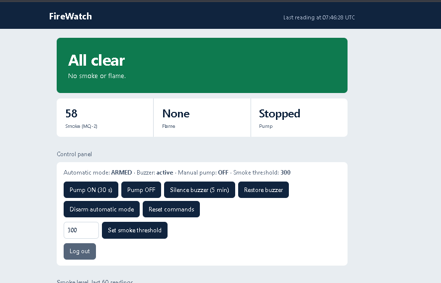

# FireWatch

Connected fire detection and suppression system: ESP8266 (MQ-2 smoke sensor, flame sensor, relay pump) + Java HTTP server with SQLite + real-time web dashboard with admin controls.



An ESP8266 board monitors smoke and flames, triggers the alarm and the water pump **locally**, and sends its measurements to a Java server. The server stores them in SQLite and displays them on a web dashboard (live chart, alert history).

## Features
- Smoke detection (adjustable threshold) and flame detection, with buzzer and LED alarm
- Automatic extinguishing by pump, with flame confirmation delay and cooldown
- Local safety: automatic mode keeps working without Wi-Fi
- Web dashboard: measurements, live chart, event history
- Password-protected admin area: manual pump, buzzer mute, smoke threshold, automatic mode arm/disarm
- Built-in simulator to test without hardware

## Architecture
```
ESP8266 --POST /api/mesures--> Java server --> SQLite (firewatch.db)
ESP8266 <--GET /api/commande-- Java server <-- Web dashboard (admin orders)
```

## Project structure
```
src/fr/firewatch/
  Main.java        HTTP server and routes
  Db.java          SQLite access (measurements, events, commands)
  Page.java        Dashboard and login page (HTML/CSS/SVG)
  Simulateur.java  ESP8266 simulator
arduino/FireWatch_ESP8266/anti_incendie_connecte/
  anti_incendie_connecte.ino   NodeMCU firmware
```

## Hardware wiring (NodeMCU ESP8266)
| Component | Pin |
|---|---|
| MQ-2 smoke sensor (analog) | A0 |
| Flame sensor | D5 |
| Buzzer | D6 |
| Alarm LED | D7 |
| Relay module (pump) | D1 |

> The MQ-2 analog output can reach 5 V while the NodeMCU A0 input is limited to 3.3 V: use a voltage divider. Power the pump with a separate supply through the relay.

## Run the server (NetBeans 8.2, JDK 8)
1. Download `sqlite-jdbc-3.36.0.3.jar` and add it in **Libraries → Add JAR/Folder**.
2. Set the main class to `fr.firewatch.Main` (**Properties → Run**).
3. Run the project, then open http://localhost:3000.
4. Without hardware, run `Simulateur.java` (**Run File**).

## Configuration
- Environment variables `API_KEY` and `ADMIN_PASSWORD` (and `PORT`, default `3000`): set your own values.
- In the Arduino sketch, fill in `WIFI_SSID`, `WIFI_PASS`, `SERVER_BASE` (IP of the computer running the server) and the same `API_KEY`.
- Allow Java through the Windows firewall (private network, port 3000) so the ESP8266 can reach the server.

## API
| Route | Method | Description |
|---|---|---|
| `/` | GET | Dashboard |
| `/login`, `/logout` | GET/POST | Admin session |
| `/commande` | POST | Admin orders (pump, mute, threshold, auto mode) |
| `/api/mesures` | POST | Measurements from the ESP8266 (header `x-api-key`) |
| `/api/commande` | GET | Orders read by the ESP8266: `pump mute threshold auto` (header `x-api-key`) |

## Technologies
ESP8266 / Arduino C++ · Java 8 (JDK HTTP server) · SQLite (JDBC) · HTML/CSS/SVG
